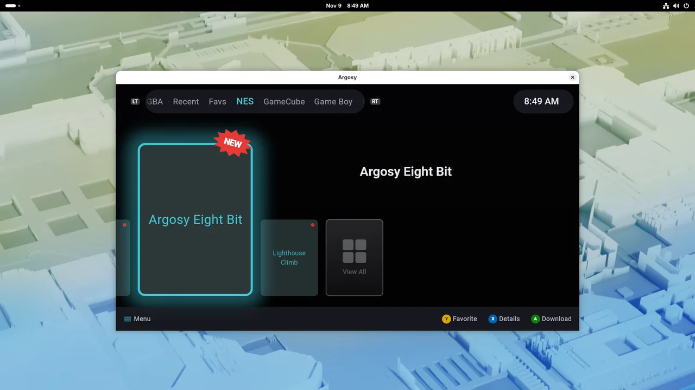
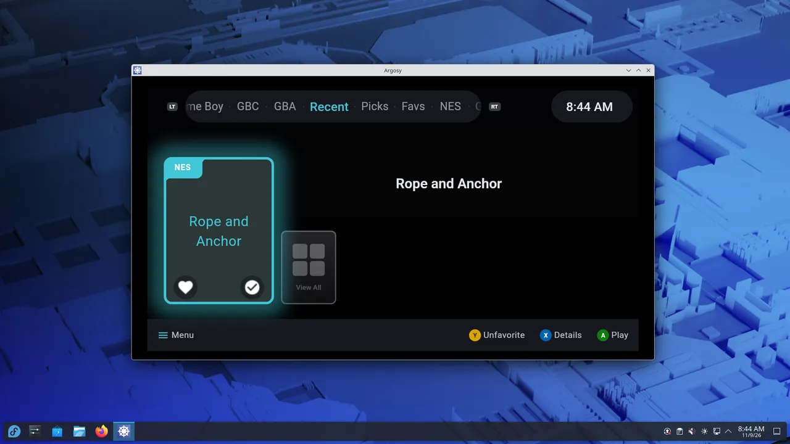
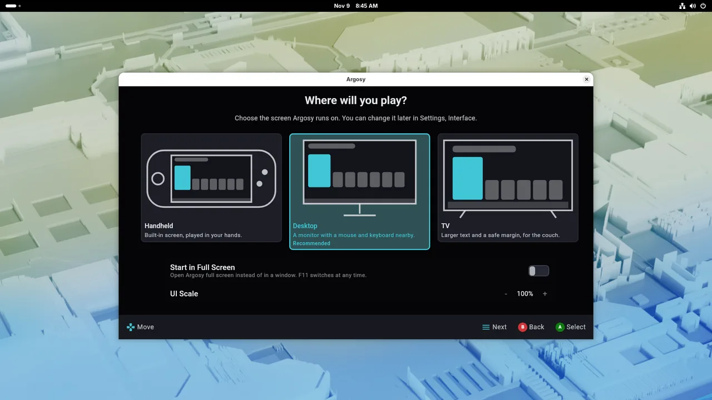
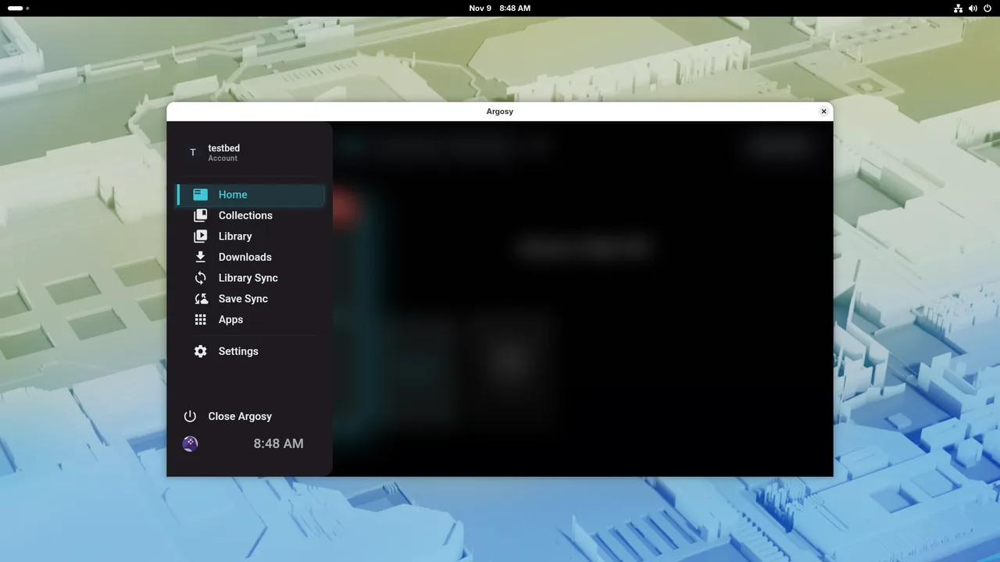
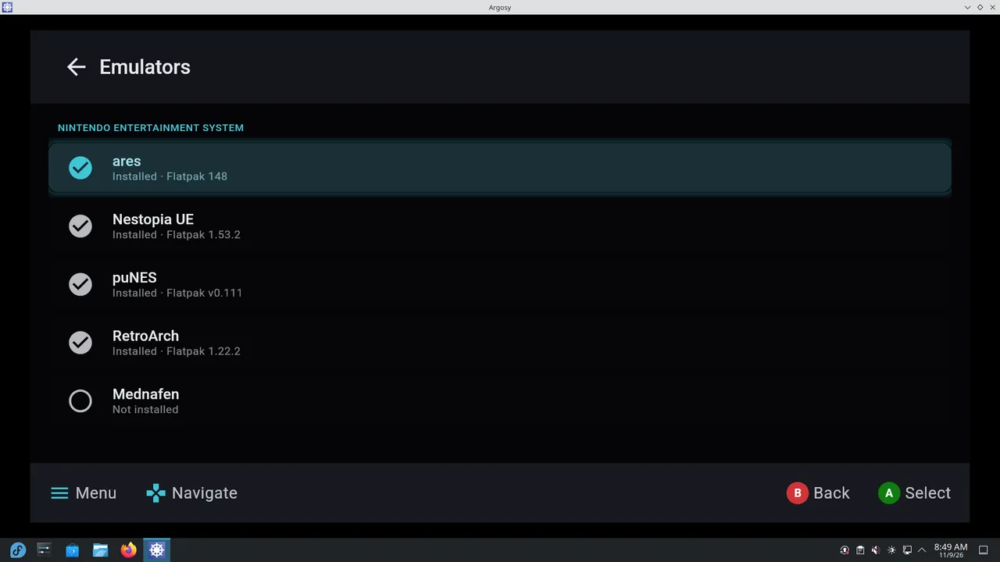
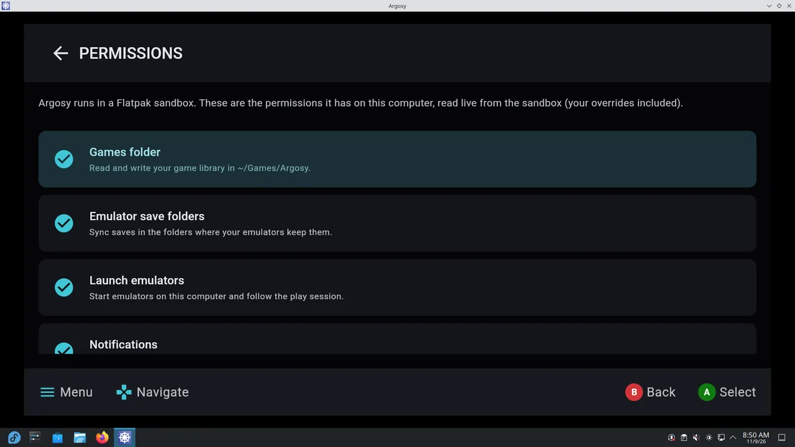

# Argosy Desktop

A Linux port of the [Argosy launcher](https://github.com/rommapp/argosy-launcher), shipped as a Flatpak. It runs Argosy's own interface on the Linux desktop and connects to a [RomM](https://github.com/rommapp/romm) server for your library, downloads and save sync. Play from a PC handheld, a mouse and keyboard, or from the couch.

> **Status: Beta (0.4.0).** Current version is considered feature-complete. Testing in production is now the current status, and if all goes well this app will be submitted to flathub by November 15th. 

An independent fork of `rommapp/argosy-launcher`, licensed GPL-3.0 like upstream. Not an official rommapp release.

## At a glance

### Desktop features

- **Display profiles:** Handheld, Desktop and TV, detected automatically and chosen in setup. TV adds couch-scale text, a safe-area margin and a focus glow.
- **Windows:** title bar when windowed, F11 or a setting for full screen, `--windowed` / `--fullscreen`, full screen under gamescope.
- **Input:** Steam Input or SDL3 controllers, per-controller button mapping, Xbox/PlayStation/Nintendo/Steam glyphs, mouse hover and click, Start as Next in setup.
- **Emulators:** a Linux compatibility database, consented Flathub installs, AppImage and Flathub updates, and 21 desktop-only emulators.
- **Save sync** for RetroArch and standalone emulators, in place, including EmuDeck layouts.
- **Linux screens:** Flatpak Permissions, a read-only host GPU page, an Apps tab for desktop applications, Quick Settings for volume and rumble.
- **Steam Game Mode:** emulator windows join Argosy's Steam launch, and Steam's controller settings reach the emulators.
- **Close Argosy** in the left menu and Settings; Factory Reset restarts into setup.

### How it differs from Android

The desktop app aims at Linux adaptation, not a 1:1 copy. Every difference is a desktop-only switch; the Android app is unchanged.

- **Removed:** Steam library import, Jellyfin, Argosy Social, the Android Settings row.
- **Not yet:** built-in libretro emulation and netplay (games run in external emulators), dual-screen, YouTube trailers.
- **Replaced:** Play Store suggestions → Flathub; APK installers → AppImage and Flathub management; GPU driver downloads → a host GPU page; Android permissions → Flatpak permissions.
Details and dates: [`PORT_PLAN.md`](PORT_PLAN.md), "Desktop divergences".

| GNOME | KDE Plasma |
| --- | --- |
|  |  |

What the desktop version adds:

| Setup picks a display profile | Left menu replaces the shoulder-button switcher |
| --- | --- |
|  |  |
| **Emulators manager for Linux emulators** | **Flatpak permissions, read live from the sandbox** |
|  |  |

- Same Compose UI as the Android app, through Compose Multiplatform, so themes, sounds and focus behaviour match.
- Finds emulators installed as Flatpaks, AppImages, through EmuDeck or on `PATH`, launches them on the host and syncs their saves when the session ends.
- Handheld, Desktop and TV profiles, windowed or full screen (F11), with gamepad, mouse and keyboard input.

## Install

You need Flatpak (preinstalled on Fedora, SteamOS, Bazzite and Linux Mint; on Ubuntu, `sudo apt install flatpak`).

```bash
flatpak install --user --from https://stealthx3.github.io/argosy-desktop/io.github.stealthx3.ArgosyDesktop.flatpakref
flatpak run io.github.stealthx3.ArgosyDesktop
```

The setup wizard asks for your RomM server, signs you in, picks a display profile and lists the emulators Argosy can manage. RetroArch is the usual first one:

```bash
flatpak install --user flathub org.libretro.RetroArch
```

- **Steam Deck:** install in Desktop Mode, add Argosy Desktop to Steam as a non-Steam game, then start it from Game Mode.
- **Updates:** `flatpak update` (the repository is signed; your data stays).
- **Uninstall:** `flatpak uninstall --user io.github.stealthx3.ArgosyDesktop` (add `--delete-data` to remove settings; games in `~/Games/Argosy` stay).

This is a beta: back up emulator saves before turning on Save Sync, and attach `argosy-run.log` from `~/.var/app/io.github.stealthx3.ArgosyDesktop` to bug reports.

## How it works

Argosy's single Android module was restructured into a Kotlin Multiplatform `shared` module. `commonMain` holds about 1,700 of Argosy's files (UI, view models, domain, RomM data layer); thin `androidMain` and `desktopMain` layers supply the platform services:

| Android | Linux |
| --- | --- |
| Intents, package manager | Emulator registry, host launch via `flatpak-spawn --host` |
| Gamepad key events | SDL3 into Argosy's input dispatcher |
| WorkManager / ExoPlayer | Coroutine job queue / libmpv |
| Storage and permissions | XDG folders, portals, Flatpak permissions |
| Hilt / Room / DataStore | Dagger / multiplatform Room and DataStore, same schema |

The restructure is scripted (`scripts/desktop/restructure/`) so it re-applies to each upstream release; the read-only `upstream` branch tracks rommapp's newest stable release. Changes are checked with the Android unit tests, A/B screenshots, live save-sync proofs against a RomM test server, and a VM lab (`scripts/desktop/vmlab/`) covering several desktops and gamescope.

## Building from source

JDK 21 is required; the Android SDK only for the Android app.

```bash
git clone https://github.com/Stealthx3/argosy-desktop.git
cd argosy-desktop
git submodule update --init --recursive
./gradlew :desktopApp:run
```

Without the Android SDK: `ANDROID_HOME=$(mktemp -d) ./gradlew -Pargosy.desktopOnly=true :desktopApp:assemble`. Flatpak builds: `scripts/desktop/flatpak/build-alpha.sh`, or the offline from-source manifest in `desktopApp/flatpak/`.

| Path | Contents |
| --- | --- |
| `shared/` | Multiplatform module: `commonMain`, `androidMain`, `desktopMain` |
| `app/`, `desktopApp/` | Android app; desktop entry point, SDL3 input, Flatpak manifests |
| `scripts/desktop/` | Restructure tooling, walks, VM lab, Flatpak publishing |
| `docs/desktop/` | Phase handoffs, runbooks, Flathub plan, screenshots |
| `PORT_PLAN.md`, `DEVLOG.md` | Full port plan; action-and-reasoning log |

## Credits and license

Argosy is by the [rommapp](https://github.com/rommapp) team; upstream's README is kept as [`README.upstream.md`](README.upstream.md). Argosy Desktop is licensed under the [GNU GPL v3.0](LICENSE).
