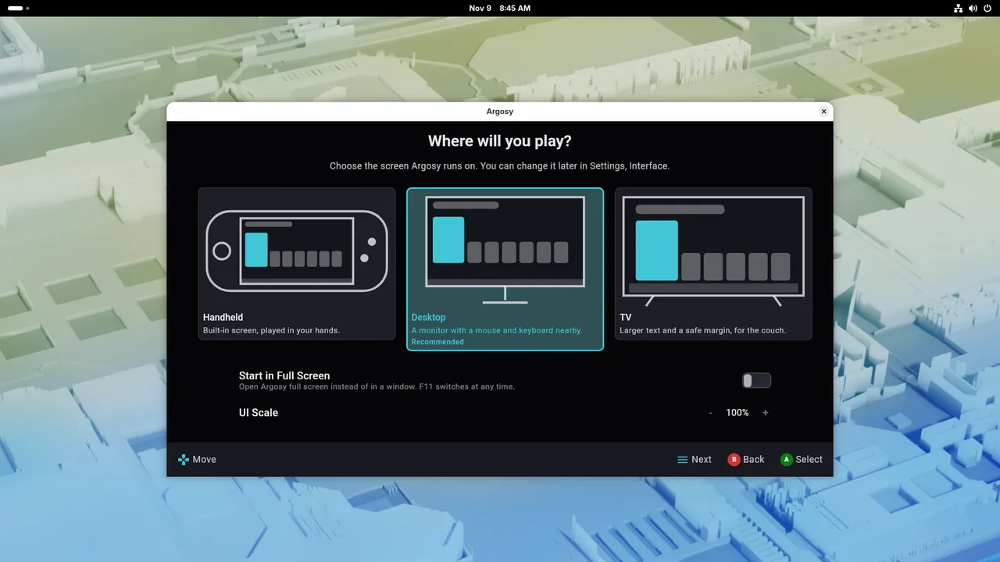
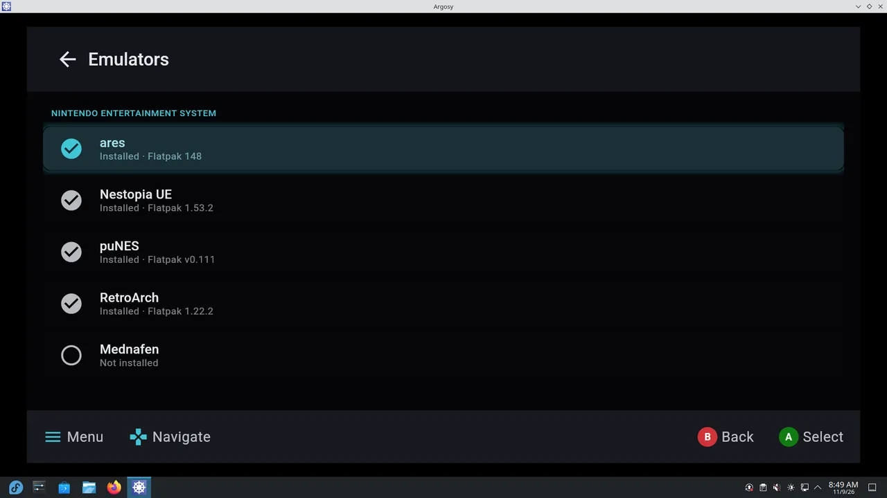

# IceBreaker

> [!IMPORTANT]
> **IceBreaker has a new app ID: `io.github.stealthx3.icebreaker-client`** (from 1.0.1). It was `io.github.stealthx3.icebreaker-client`, and before that Argosy Desktop's `io.github.stealthx3.ArgosyDesktop`. The name stays IceBreaker. Releases come from [IceBreaker's own Flatpak repository](https://stealthx3.github.io/icebreaker-client/) (test builds from the [IceSuite test repository](https://stealthx3.github.io/icesuite-test/)). The old IDs get no more updates.
>
> **Already have IceBreaker or Argosy Desktop?** Pick one:
>
> - **Update in place:** run `flatpak update --user` and answer **yes** when it offers to replace the old app with `io.github.stealthx3.icebreaker-client`. Settings, sign-in and downloads move with it.
> - **Install fresh:** remove the old app with `flatpak uninstall --user <old ID>` (without `--delete-data`), then install IceBreaker as shown under [Install](#install). On its first start, IceBreaker moves the old app's settings and downloads over.
>
> **Added IceBreaker to Steam?** After the switch, open **Settings → Add to Steam** and add it again with Steam closed; the existing shortcut is updated in place and keeps its play time.
>
> Coming from Argosy Desktop, your games folder `~/Games/Argosy` becomes `~/Games/IceBreaker` on the first start, and the saved paths follow it. Emulator saves are not touched.

IceBreaker is a Linux port of the [Argosy launcher](https://github.com/rommapp/argosy-launcher), shipped as a Flatpak. Based on Argosy by the RomM team; an independent port, not affiliated with or endorsed by rommapp. It runs Argosy's own interface on the Linux desktop and connects to a [RomM](https://github.com/rommapp/romm) server for your library, downloads and save sync. Play from a PC handheld, a mouse and keyboard, or from the couch.

> **Status: 1.0.1, the first release under the app ID `io.github.stealthx3.icebreaker-client`.** A Flathub listing is in preparation.

An independent fork of `rommapp/argosy-launcher`, licensed GPL-3.0 like upstream. Not an official rommapp release.

Most of the desktop port was written with an AI coding assistant (Claude), directed by the project's owner. [AI-DISCLOSURE.md](AI-DISCLOSURE.md) says what that covers and where it ends.

## At a glance

### Desktop features

- **Display profiles:** Handheld, Desktop and TV, detected automatically and chosen in setup. TV adds couch-scale text, a safe-area margin and a focus glow.
- **Windows:** title bar when windowed, F11 or a setting for full screen, `--windowed` / `--fullscreen`, full screen under gamescope.
- **Input:** Steam Input or SDL3 controllers, per-controller button mapping, Xbox/PlayStation/Nintendo/Steam glyphs, mouse hover and click, Start as Next in setup.
- **Emulators:** a Linux compatibility database, consented Flathub installs, AppImage and Flathub updates, Emudeck co-existence, and 21 desktop-only emulators.
- **Save sync** for RetroArch and standalone emulators, in place, including EmuDeck layouts.
- **Linux screens:** Flatpak Permissions, a read-only host GPU page, an Apps tab for desktop applications, Quick Settings for volume and rumble.
- **Steam Game Mode:** emulator windows join Argosy's Steam launch, and Steam's controller settings reach the emulators.
- **Close IceBreaker** in the left menu and Settings; Factory Reset restarts into setup.

### How it differs from Android

The desktop app aims at Linux adaptation, not a 1:1 copy. Every difference is a desktop-only switch; the Android app is unchanged.

- **Removed:** Steam library import, Jellyfin, Argosy Social, the Android Settings row.
- **Not yet:** built-in libretro emulation and netplay (games run in external emulators), dual-screen, YouTube trailers.
- **Replaced:** Play Store suggestions → Flathub; APK installers → AppImage and Flathub management; GPU driver downloads → a host GPU page; Android permissions → Flatpak permissions.
Details and dates: [`PORT_PLAN.md`](PORT_PLAN.md), "Desktop divergences".

| Home | Game details |
| --- | --- |
|  |  |

What the desktop version adds:

| Left menu replaces the shoulder-button switcher | Add to Steam with the brand artwork |
| --- | --- |
|  |  |
| **Setup picks a display profile** | **Emulators manager for Linux emulators** |
|  |  |

- Same Compose UI as the Android app, through Compose Multiplatform, so themes, sounds and focus behaviour match.
- Finds emulators installed as Flatpaks, AppImages, through EmuDeck or on `PATH`, launches them on the host and syncs their saves when the session ends.
- Handheld, Desktop and TV profiles, windowed or full screen (F11), with gamepad, mouse and keyboard input.

## Install

You need Flatpak (preinstalled on Fedora, SteamOS, Bazzite and Linux Mint; on Ubuntu, `sudo apt install flatpak`).

Install the stable release from IceBreaker's own Flatpak repository (signed; `flatpak update` keeps it current):

```bash
flatpak install --user --from https://stealthx3.github.io/icebreaker-client/io.github.stealthx3.icebreaker-client.flatpakref
```

Or add the repository once and install from it:

```bash
flatpak remote-add --user --if-not-exists icebreaker https://stealthx3.github.io/icebreaker-client/icebreaker.flatpakrepo
```

```bash
flatpak install --user icebreaker io.github.stealthx3.icebreaker-client
```

Test builds come from the IceSuite test repository ([Stealthx3/icesuite-test](https://github.com/Stealthx3/icesuite-test)), which serves every IceSuite app.

Beta testers who installed `io.github.stealthx3.ArgosyDesktop` from the old project repo: see the notice at the top of this page.

The setup wizard asks for your RomM server, signs you in, picks a display profile and lists the emulators IceBreaker can manage. RetroArch is the usual first one:

```bash
flatpak install --user flathub org.libretro.RetroArch
```

- **Steam and Steam Deck:** **Settings → Add to Steam** (also offered once at the end of setup) adds IceBreaker to Steam with its capsule, banner, logo and icon, in the `IceSuite` collection. Quit Steam completely first, including its tray icon. On a Deck, do this in Desktop Mode, then start IceBreaker from Game Mode. Steam from Flathub also needs, once: `flatpak override --user --talk-name=org.freedesktop.Flatpak com.valvesoftware.Steam`.
- **Updates:** `flatpak update` (the repository is signed; your data stays).
- **Uninstall:** first use **Settings → Add to Steam → Remove from Steam** if you added it (Flatpak cannot remove the Steam shortcut on uninstall), then `flatpak uninstall --user io.github.stealthx3.icebreaker-client` (add `--delete-data` to remove settings; games in `~/Games/IceBreaker` stay).

Back up emulator saves before turning on Save Sync. Report bugs in [Issues](https://github.com/Stealthx3/icebreaker-client/issues) with a log of a run that shows the problem:

```bash
flatpak run io.github.stealthx3.icebreaker-client > ~/icebreaker-run.log 2>&1
```

Releases, including single-file `.flatpak` bundles for x86_64 and aarch64, are on the [Releases page](https://github.com/Stealthx3/icebreaker-client/releases).

## How it works

Argosy's single Android module was restructured into a Kotlin Multiplatform `shared` module. `commonMain` holds about 1,700 of Argosy's files (UI, view models, domain, RomM data layer); thin `androidMain` and `desktopMain` layers supply the platform services:

| Android | Linux |
| --- | --- |
| Intents, package manager | Emulator registry, host launch via `flatpak-spawn --host` |
| Gamepad key events | SDL3 into Argosy's input dispatcher |
| WorkManager / ExoPlayer | Coroutine job queue / libmpv |
| Storage and permissions | XDG folders, portals, Flatpak permissions |
| Hilt / Room / DataStore | Dagger / multiplatform Room and DataStore, same schema |

The restructure is scripted (`scripts/desktop/restructure/`) so it re-applies to each upstream release; the read-only `upstream` branch tracks rommapp's newest stable release. Changes are checked with the Android unit tests, A/B screenshots, live save-sync proofs against a RomM test server, and a VM lab (`scripts/desktop/vmlab/`) covering several desktops and gamescope.

## Building from source

JDK 21 is required; the Android SDK only for the Android app.

```bash
git clone https://github.com/Stealthx3/icebreaker-client.git
cd IceBreaker
git submodule update --init --recursive
./gradlew :desktopApp:run
```

Without the Android SDK: `ANDROID_HOME=$(mktemp -d) ./gradlew -Pargosy.desktopOnly=true :desktopApp:assemble`. Flatpak builds: `scripts/desktop/flatpak/build-alpha.sh`, or the offline from-source manifest in `desktopApp/flatpak/`.

| Path | Contents |
| --- | --- |
| `shared/` | Multiplatform module: `commonMain`, `androidMain`, `desktopMain` |
| `app/`, `desktopApp/` | Android app; desktop entry point, SDL3 input, Flatpak manifests |
| `scripts/desktop/` | Restructure tooling, walks, VM lab, Flatpak publishing |
| `docs/desktop/` | Phase handoffs, runbooks, Flathub plan, screenshots |
| `PORT_PLAN.md`, `DEVLOG.md` | Full port plan; action-and-reasoning log |

## Credits and license

Argosy is by the [rommapp](https://github.com/rommapp) team; upstream's README is kept as [`README.upstream.md`](README.upstream.md). IceBreaker is licensed under the [GNU GPL v3.0](LICENSE).
