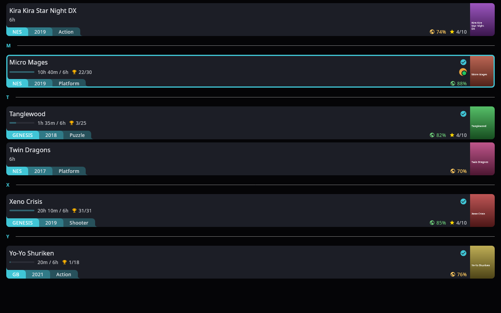

# Spike: upstream Library UI in a Compose desktop window

Phase 0 spike. Standalone Gradle build (Kotlin 2.3.20, Compose Multiplatform 1.12.2), not wired
into the root build.

Renders upstream's `LibraryGameList` (the Library list view), inside upstream's `ALauncherTheme`,
on the desktop. Upstream code compiles **unchanged**. What is Android-bound is answered by shims at
the Android API's own package name, so the shim list below is the list of APIs Phase 2 must give a
desktop implementation (`expect`/`actual` or a common abstraction).

```sh
./copy-sources.sh               # copy upstream files listed in upstream-files.txt
python3 -I extract_decls.py     # copy single declarations listed in extracted-decls.txt
./gradlew renderPng             # headless render -> library.png (JDK 17+)
./gradlew run                   # same composable in a desktop window
```



Covers are generated placeholders (title on a gradient), not box art. Titles are homebrew games.

## Source layout and sizes

| Source set | What it holds | Files | Lines |
|---|---|---|---|
| `src/upstream` | Upstream files, copied byte-for-byte | 71 | 9,112 |
| `src/extracted` | 61 upstream declarations, copied verbatim out of 17 files too entangled to take whole | 17 | 1,002 |
| `src/shims` | Stand-ins for Android / AndroidX / Coil / Hilt APIs, at their real package names | 17 | 350 |
| `src/main` | Spike code: fake view models, two desktop replacements, fake data, entry points | 11 | 372 |
| `src/generated` | `R` (6,254 strings, 225 plurals, 37 drawables) generated from `app/src/main/res` | — | — |

Upstream's real resources are used as-is: English strings and plurals from `res/values/strings*.xml`,
vector drawables from `res/drawable` (Compose desktop reads Android vector XML), and platform SVGs from
`assets/platforms`.

## Android APIs shimmed (sizes Phase 2)

| API | Used for | Desktop answer |
|---|---|---|
| `R.string` / `R.plurals` / `R.drawable`, `stringResource`, `pluralStringResource`, `painterResource` | every label and icon | generated `R` over upstream's res; vector XML via `loadXmlImageVector` |
| `Context.getString`, `Resources.getQuantityString`, `Context.assets` | labels built outside composition; platform SVG lookup | resource table; assets on the classpath |
| `LocalContext`, `LocalConfiguration`, `LocalView` | theme, grip reserve, frosted surfaces | provided from the window size |
| `android.graphics.Color` (HSV), `androidx.core.graphics.ColorUtils` (HSL), `String.toColorInt()` | accent and palette maths | `java.awt.Color` HSB / same formulas |
| `android.os.Build.VERSION` | API-level gates (blur needs S+) | reports API 35: Skia supports what S gates |
| `android.util.Base64`, `android.graphics.BitmapFactory`, `Bitmap.asImageBitmap()` | QuayPass avatar doodles and PNG avatars | `java.util.Base64`, Skia decode |
| `android.text.format.DateFormat` | clock and date labels | JDK locale patterns (best-effort skeletons) |
| `android.content.Intent` (type only) | launch-picker state carries `onLaunch: (Intent) -> Unit` | empty type |
| `coil.compose.AsyncImage` | covers, platform logos, avatars | Skia decode / SVG on `Dispatchers.IO` |
| `hiltViewModel()` | `ALauncherTheme` gets its `ThemeViewModel` | registry of fakes |
| `BuildConfig.DEBUG` | debug palette override | `false` |

## Replaced or faked (not compiled from upstream)

| Upstream | Why it cannot compile on the desktop | Spike stand-in |
|---|---|---|
| `LibraryViewModel` (2,568 lines, Hilt) | DI, DAOs, sounds, sync; `LibraryUiState` is declared in the same file | fake with the 6 members the list calls (bodies copied); `LibraryUiState` extracted |
| `ThemeViewModel` (Hilt) | DataStore preferences | fake: `ThemeState()` defaults, dark mode |
| `ImageCacheManager` (2,352 lines) | Android cache, WorkManager, Coil | stub of the 3 calls `Coil.kt` makes |
| `ui/theme/backdrop/BackdropStamps.kt` | Hilt entry point, Coil `ImageRequest`, `android.graphics.Canvas`/`Bitmap` | empty provider (PLATFORMS backdrop draws no stamps) |
| `ui/theme/backdrop/SurfaceBackdrop.kt`, `BackdropTile.kt` | mutate `android.graphics.Shader.setLocalMatrix` per frame; Skia shaders are immutable | not needed by the list; `LocalSurfaceBackdrop` extracted |
| `CustomFontLoader` (in `CustomFonts.kt`) | `Typeface`, `android.graphics.fonts` fallback chains | Skia `Font(file)`; the rest of the file extracted |
| `Modifier.focusGlow` (in `FocusModifiers.kt`) | `nativeCanvas` + `android.graphics.BlurMaskFilter` | same drawing with Skia `MaskFilter.makeBlur` |

## Findings for Phase 2

- **The UI layer ports.** 71 upstream files compiled for the desktop without an edit. Theme, tokens,
  typography, list rows, footers, badges, titles, frosted surfaces, doodle avatars and upstream's own
  scroll-to-focus effects all run.
- **Android touchpoints in this closure are thin.** Besides resources and DI, the real platform code is
  four spots: shader matrix animation (backdrop), blur mask (focus glow), bitmap decoding, and font
  fallback. Each is small enough for an `expect`/`actual`.
- **Resources are the biggest mechanical item.** 6,254 strings and 225 plurals are reached through
  `R`/`stringResource`/`Context.getString` from shared code. Moving to Compose Multiplatform resources
  (`composeResources/`, generated `Res`) is the clean route and also covers drawables and fonts.
- **State types live inside view-model files.** `LibraryUiState`, `LibraryGridItem`, `LibraryGameUi`,
  `ThemeState`, `GameDownloadIndicator`, preference enums (inside the 1,297-line
  `UserPreferencesRepository`) and launch-picker states (inside `GameLaunchDelegate`) had to be pulled out
  one declaration at a time. Moving them to their own files is a cheap, upstream-friendly first step.
- **Threading:** with `kotlinx-coroutines-swing`, `Dispatchers.Main` is the AWT thread. A headless
  `ImageComposeScene` must be driven on that thread or Compose's posted layout callbacks collide with it
  (`performMeasureAndLayout called during measure layout`).
